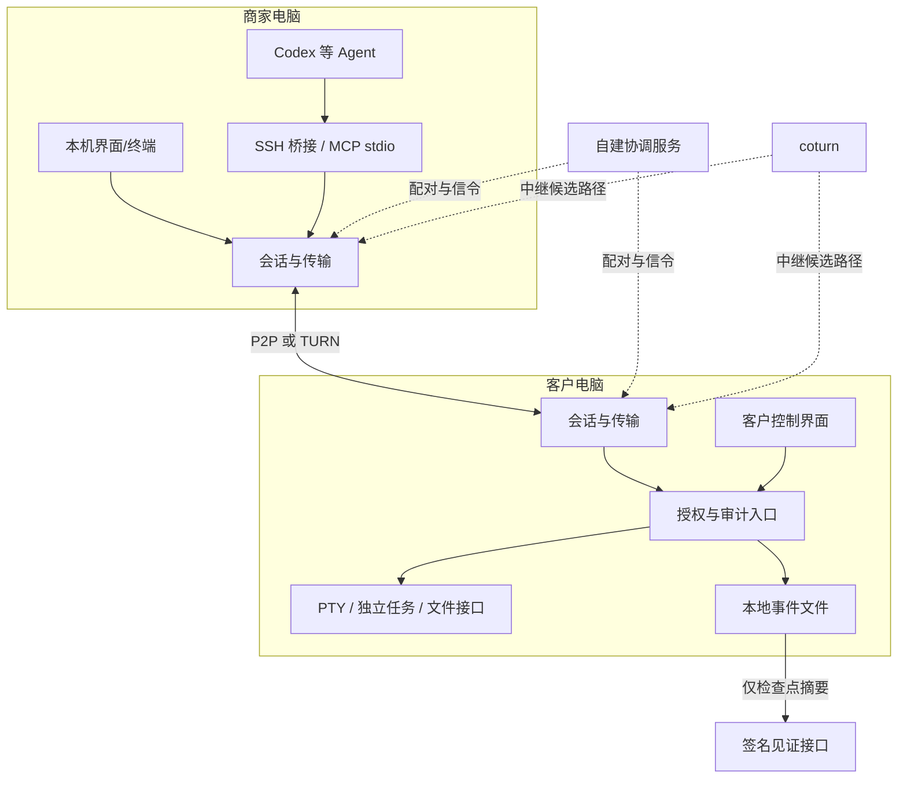

# PairShell 技术设计与开发规范

状态：待实现的完整版本设计，非现有功能说明  
版本：1.0  
日期：2026-11-15  
定位：开源、可自建的临时远程终端配对工具

## 1. 项目目标与范围

客户运行便携客户端，确认对端身份并开启本次协助；商家通过终端、SSH 或 MCP 操作。客户端负责实际授权、执行和审计。网络层同时支持 P2P 与中继，自动选择近期测量下更快且稳定的路径。

项目不建设业务平台：不做商家账号、租户、服务单、资产库、支付、设备长期托管、无人值守入口或多人协同编辑。同一服务器承载多对会话，通过独立临时身份和能力凭据隔离。

完整交付包括：

- Windows、macOS、Linux 原生客户端；同一客户端提供商家与客户两种角色。
- 一次性邀请、对端密钥验证、客户开始/暂停/结束控制。
- P2P、TURN 中继、自动选路、连接切换与断线处理。
- 交互终端、独立任务、受控文件接口。
- 原生 SSH 接入与本地 MCP stdio 接入。
- 本地审计、终端回放、完整性校验、远端签名回执。
- 自建服务器、部署配置、协议说明、构建和使用文档。

本文中的命令、接口和结构均为拟实现规范。开发可以按依赖顺序推进，最终交付不以删减功能的 MVP 结束。

## 2. 核心原则与能力边界

1. 客户端最终决定是否执行，服务器和 Agent 提示词都不能替代该检查。
2. 客户无需系统 SSH Server、模型账号、Python、Node.js 或 Docker。
3. 系统账号权限是实际边界。任意 Shell 一旦获准，不能靠命令黑名单可靠限制其副作用。
4. 日志覆盖本工具受控入口，不等于操作系统全部行为。无输出的后台动作、外部文件变化不自动具有完整语义记录。
5. 防篡改指可检测的记录完整性与见证，不承诺管理员无法杀进程、删除文件或替换客户端。
6. 结束不会回滚已完成修改，也不保证清除已建立的系统服务、计划任务等脱离进程树的工作。
7. 不承诺所有网络都能打洞或中继成功。界面必须暴露明确的失败原因。
8. 不自研密码算法、SSH、ICE、TURN 或终端模拟器。

## 3. 交付形态与依赖

| 模块 | 选型 | 说明 |
| --- | --- | --- |
| 客户端/协调服务 | Go | 按平台构建，无客户端语言运行时安装步骤 |
| P2P 数据通道 | Pion WebRTC | 使用可靠、有序 DataChannel，启用 ICE |
| STUN/TURN | coturn | 自建现有服务，不复写协议 |
| SSH | golang.org/x/crypto/ssh | 客户侧受控 SSH 服务；对端密钥固定绑定 |
| Unix PTY | creack/pty 等现有组件 | 评估并固定版本后采用 |
| Windows PTY | ConPTY 现有封装 | 可参考 Upterm 使用的封装与清理实现 |
| 界面 | Go 内嵌静态资源 + 本机浏览器 | 无 Electron；不从 CDN 加载脚本 |
| 终端界面 | xterm.js | 将依赖及许可证一并打包 |
| MCP | 维护中的 Go MCP SDK | 实现前确定版本，禁止临时自造不兼容协议 |
| 审计密码 | Go 标准库 SHA-256、Ed25519 | 不增加自制密码原语 |

发布程序为 `pairshell` 与 `pairshelld`，服务器另运行 coturn。提供 Docker Compose 和原生部署两种说明；Docker 只用于服务端可选部署。

不将整个 Upterm Fork 作为最终框架，避免保留其原中继体系又叠加 WebRTC。按许可证复用或参考其 PTY、ConPTY、SSH 生命周期及测试。必须保留适用的版权、许可证和修改说明，审查传递依赖；不得以复制代码省略许可履行。

依赖版本必须在实现时固定并验证，不根据本设计文档猜测 API。产品不预先承诺体积、内存和并发数，发布报告提供实际测量。

## 4. 架构



SSH 内容保持端到端加密；协调服务器与 TURN 不持有两端 SSH 私钥。信令必须经过配对认证，防止服务器替换端点身份。服务器仍可拒绝服务或观察连接元数据，不宣称隐藏元数据。

## 5. 使用流程

1. 商家运行 `pairshell merchant`，选择服务器并创建邀请。
2. 客户运行 `pairshell customer`，粘贴邀请链接。
3. 两端展示一致的校验词、公钥指纹与服务器地址；客户通过既有聊天渠道核对。
4. 客户确认本次人工/Agent 操作方式、权限与日志位置。
5. 客户创建日志并完成写入检查，随后开放远程操作。
6. 连接建立后进入协助；客户查看终端和所有独立任务输出。
7. 客户结束：撤销会话、拒绝新操作、关闭路径、清理受控进程、尽力完成审计收尾。
8. 显示最终状态、日志位置、见证范围和未完成清理项。

默认每个会话只允许一个商家端身份。商家程序可以管理多个会话，但每个 SSH/MCP 适配器实例固定绑定一个会话，不允许 Agent 通过请求参数切换目标客户。

## 6. 配对协议与身份绑定

### 6.1 临时身份

每次会话两端各生成临时 Ed25519 密钥。SSH 认证密钥、客户 SSH 主机密钥和信令中声明的身份需要通过配对认证绑定。密钥不跨会话作为永久访问凭据复用。

会话包含：`session_id`、两端临时公钥、协议版本、授权版本、过期时间、权限、撤销状态。显示名不作为可信身份来源。

### 6.2 邀请结构

示意格式：

```text
https://relay.example/pair#v=1&sid=...&join=...&secret=...&merchant_key=...&exp=...
```

- `session_id`：至少 128 位密码学随机值。
- `join`：独立的 256 位一次性房间领取能力凭据，服务器验证后原子领取。
- `secret`：独立的 256 位端到端配对秘密，不交给协调服务器。
- `merchant_key`：商家本次公钥。
- 过期字段必须参加认证，不能直接信任未经认证的 URL 值。

邀请中敏感信息使用 URL fragment；客户端解析后不得输出到普通日志、崩溃报告、子进程参数或遥测。邀请页不含第三方脚本。fragment 仍可能被浏览器历史、剪贴板等读取，不能当作秘密存储机制。

不依赖自定义 URL scheme 完成便携版配对，主流程为粘贴邀请。不得自动将含秘密的邀请上传作预览。

### 6.3 握手

1. 商家在可信 TLS 连接上创建临时房间，服务端返回创建者凭据与领取凭据。
2. 客户使用领取凭据提交公钥；房间原子限制为一名客户。
3. 两端以配对秘密通过标准 HMAC-SHA256 认证握手转录。
4. 转录包含版本、角色、会话 ID、双方公钥、双方随机挑战、过期时间和协商能力；每条信令另含序号和消息类型。
5. SDP、DTLS 指纹及 ICE 连接信息必须受该认证保护；重放、角色反射、跨会话消息均拒绝。
6. 双方证明持有各自私钥，客户确认后建立 SSH；主机密钥必须与已验证握手一致。
7. 校验词由完整认证转录导出，用于外部核对；不得以自报名称代替。

实现前为握手编码、域分离、密钥派生、挑战和重放检查补齐精确协议及测试向量，并接受安全审查。不得把本节概要当作无需审查的新密码协议。

服务器掌握房间能力凭据，可影响可用性，但不应知道端到端秘密。重启后清空房间，旧会话不自动恢复授权。

### 6.4 多对会话隔离

每个房间独立凭据、密钥和有效期；API 不暴露全局在线列表。每条消息校验房间、角色、协议和授权版本。旧邀请、旧授权版本和已撤销会话不能重连。未知房间与无权限请求不泄露可枚举信息。

## 7. 状态机和客户控制

```text
IDLE → INVITED → PAIRING → AWAITING_CONSENT → CONNECTING → ACTIVE
ACTIVE ↔ PAUSED
ACTIVE / PAUSED → RECONNECTING → 原先运行状态
任意已启动状态 → ENDING → ENDED
不可恢复故障 → ENDING → FAILED
```

暂停状态必须跨连接切换保持，禁止重连自动恢复执行。

客户侧唯一的授权入口管理：

```text
session_id / authorization_epoch / state / peer_key /
enabled_capabilities / consent_mode / expires_at
```

每次启动任务、处理远程输入、读取文件及每个文件写入阶段都检查状态。结束操作先原子增加授权版本并撤销权限，再清理连接，避免备用路径抢先执行。

默认允许终端；独立任务、文件读写和 AI 辅助在客户界面分别明确展示并授权。任意终端已有广泛能力，这些开关限制工具入口，不承诺能约束获准 Shell 的全部文件行为。

界面与执行逻辑分离，进程管理器能在终端阻塞时处理结束。相同用户或管理员级远程 Shell 仍可能干扰控制程序；本设计不能提供对等权限下的绝对隔离。

提升权限由客户通过 UAC/sudo 等系统机制完成。第一版完整实现采用结束当前普通权限会话、客户确认后以提升权限的新会话重新配对，避免保留秘密提权通道。UI 明确显示权限。不得收集或保存客户提权密码。

## 8. 网络与自动选路

### 8.1 候选路径

Pion 建立可控的直连候选连接和 relay-only 备用连接，以可靠有序 DataChannel 承载会话帧。对等连接数量必须有上限；禁止无限创建探测连接。具体 ICE 过滤 API 以固定版本验证结果为准。

coturn 提供 STUN、TURN/UDP、TURN/TCP 或 TLS 可用路径。TURN/TCP/TLS 不代表所有防火墙均可穿越；需要实际网络矩阵测试。TURN 凭据短期有效，有配额和禁止访问的目标地址策略，避免成为开放代理。

### 8.2 初始策略参数

| 项目 | 默认值 | 说明 |
| --- | --- | --- |
| 探测周期 | 2 秒 | 应用层端到端 ping/pong |
| 统计窗口 | 最近 10 个样本 | 记录 RTT 中位数、抖动、超时比例 |
| 切换优势 | 至少快 10ms 且快 20% | 连续 3 个探测周期满足 |
| 切换冷却 | 15 秒 | 当前路径故障可跳过 |
| 无响应判定 | 3 次探测超时 | 联合通道关闭事件判断 |
| 恢复等待 | 最长 30 秒 | 超时结束，不永久后台重试 |

参数为可配置工程初值，不是已测性能结论。初始使用先完成认证的可用路径，后台继续发现更优路径。优先避免高丢包和超时，再比较延迟。不会为追求一时较低 RTT 持续切换。

### 8.3 路径切换与虚拟字节流

SSH 建立在一条虚拟可靠字节流之上，底层路径切换不重新执行 SSH 命令。

帧头包含：`version, session_id, authorization_epoch, stream_id, seq, ack, type, payload_length`。序号按方向独立递增，绑定已验证会话。ACK 表示传输层接收字节，不表示命令已完成。

要求：

- 唯一写入器序列化 SSH 字节；接收端先去重、排序，再交给 SSH。
- 只重传未确认帧；不能以 SSH 命令作为重放单位。
- 初始单帧负载上限 16 KiB，配置缓冲上限与背压；不把 DataChannel 消息边界当作任意长度字节流。
- 正确实现短读写、关闭、取消和 deadline 语义，适配 SSH 所需连接接口。
- 切换提交时携带序号水位；旧路径迟到数据仍去重，禁止双重注入。
- 缓存无法补齐、对端进程重启或 SSH 状态丢失时结束会话，不伪造无缝恢复。
- 可靠迁移范围仅限双方进程仍存活的会话；不承诺跨崩溃 exactly-once。

此层是必须自研的小范围适配代码。应先完成传输测试，再接入真实维修命令。

## 9. 执行、文件与取消

### 9.1 交互终端

客户拥有一个共享 PTY；商家 SSH 的 shell 请求连接该 PTY，客户页面看到同一输出。为每个输入源标记身份。记录原始输入、PTY 输出、resize、开始结束；PTY 模式下 stdout/stderr 通常合并，不伪造分离。

终端字节不能可靠推导每条命令语义和退出码。仅对独立任务提供明确命令级结果。暂停阻止新远程输入，不停止已经运行的程序。

### 9.2 独立任务

`exec.start` 结构至少包含：

```json
{
  "request_id": "随机唯一值",
  "authorization_epoch": 1,
  "shell": "powershell",
  "command": "明确的命令文本",
  "cwd": "客户允许的工作目录",
  "timeout_ms": 60000
}
```

显式区分 Shell 文本与 argv 执行，禁止将两者混用或跨 Shell 自动拼接。环境变量白名单继承，不把邀请、MCP 凭据和签名材料交给子进程。

任务状态：`ACCEPTED → RUNNING → SUCCEEDED / FAILED / CANCELED / TIMED_OUT / UNKNOWN`。记录退出码（可空）、系统错误、输出水位。重复请求 ID 返回原任务；相同 ID 不同请求体拒绝。同一会话内保存状态直至收尾。

默认只允许一个修改型执行流。交互终端与独立任务之间使用明确的写操作占用状态，避免 Agent 与人工同时修改。不得通过静态字符串判断所有命令是否只读。

### 9.3 文件入口

独立协议提供 `file.read`、`file.write`，不默认打开完整 SFTP 子系统。路径和大小有上限，记录路径、操作、大小及修改前后摘要；日志不默认复制全部文件内容。

写入使用临时文件、前置内容摘要检查和支持时的原子替换，尊重平台权限。路径限制需处理符号链接、重解析点和 TOCTOU，不能仅检查字符串前缀。不能对已授权任意 Shell 宣称路径隔离。

### 9.4 清理

Windows 优先 Job Object 与关闭清理；Unix 使用进程组及有界 TERM/KILL 流程。记录无法纳管或清理失败的子进程。取消请求与最终状态分开，禁止在发出取消信号时直接报告已终止。

## 10. SSH 与 MCP 接入

### 10.1 SSH

商家客户端导出当前会话的 SSH 配置，推荐使用：

```text
Host pairshell-current
    ProxyCommand pairshell proxy --session <本地会话引用>
    StrictHostKeyChecking yes
    UserKnownHostsFile <本次会话专用已验证主机密钥文件>
    IdentityFile <受保护的本次会话密钥文件>
    IdentitiesOnly yes
```

具体生成路径按平台确定，不把秘密直接写入命令行。`proxy` 标准输出只能承载 SSH 数据，日志进入 stderr。默认拒绝 agent/X11/TCP 转发、未知 subsystem 和额外 SSH 环境请求。

shell、exec、文件能力都进入共同授权与审计层。原生 SSH exec 通过任务管理器启动，不另开未录制的执行路径。

### 10.2 MCP

`pairshell mcp --session <本地会话引用>` 运行 stdio 服务。工具：

| 工具 | 行为 |
| --- | --- |
| `session_info` | 返回目标系统、授权、录制与连接状态 |
| `task_start` | 提交独立任务，返回任务 ID |
| `task_output` | 按游标分页读取输出，限制单次大小 |
| `task_status` | 返回当前状态与最终结果 |
| `task_cancel` | 请求取消 |
| `file_read` | 有界读取指定文件 |
| `file_write` | 带前置摘要的写入 |

目标会话来自进程启动时绑定的受保护本地引用，不接受模型传入其他客户 ID。MCP 调用记录操作员身份、连接 ID 和声明的 Agent 名称；Agent 名称是标记，不作为强身份凭据。

任务有副作用时断线先查状态，不自动重试。远端输出视作不可信数据，不能改变适配器的目标和权限。客户批准 AI 模式后才允许该入口，明确说明输出可能发送给商家使用的模型服务。

## 11. 审计与校验格式

### 11.1 单一事件源

`events.jsonl` 是权威事件源。`terminal.cast`、`transcript.txt` 和最终报告均从事件源派生，不能各自独立录制而产生不一致。原始字节以 Base64 存储，显示层安全处理 ANSI 控制序列。

事件字段至少包含：

```text
schema_version, session_id, sequence, wall_time_utc,
monotonic_elapsed_ns, actor, event_type, request_id,
authorization_epoch, payload, previous_hash, event_hash
```

保留壁钟时间和单调时间，壁钟变化作为事件记录；本地时间戳不宣称独立可信时间。

### 11.2 确定性编码

记录使用固定字段顺序、固定类型的 Go 结构；避免动态 map 参与签名。v1 不允许浮点值。哈希针对 `event_body_b64` 所包含的确切 UTF-8 字节，而非校验时重新序列化的 JSON 对象。

外层记录格式：

```json
{"event_body_b64":"...","previous_hash":"...","event_hash":"..."}
```

`event_body` 包含上述语义字段（不含哈希字段）。计算：

```text
H_i = SHA256("PairShell:event:v1\0" || previous_hash原始32字节 || event_body原始字节)
```

首事件前置哈希为零值，首事件绑定会话双方公钥、协议与授权摘要。校验器检查序号连续、会话一致、未知版本、长度上限、哈希链与最终清单。提供固定测试向量。

### 11.3 写入与失败策略

- 日志成功创建并完成初始落盘检查后才开放执行。
- 远程输入先记录接收意图并落盘，再交给 PTY；另外记录实际写入字节数和错误。不得混同意图与成功。
- 远程输入按有界小批次合并以控制同步写开销，不逐字符无限刷盘。
- 输出分块写日志后再发送商家；同步周期初值 1 秒，承认异常断电的尾部丢失窗口。
- 日志 IO 错误立即阻止新输入与新任务，并尝试终止受控执行。
- 磁盘配额不足不能滚动删除旧证据来继续运行；暂停并告知客户。
- 对巨大输出设置有界缓冲和背压，禁止静默丢弃却标记为完整。

### 11.4 见证协议

默认每 2 秒或每累计 256 KiB（先到为准）提交检查点；正常结束再提交最终检查点。请求绑定 `session_id, sequence, chain_head, checkpoint_index, previous_receipt_hash, final`。

见证端在会话建立时验证两端对会话声明的签名，后续检查点由客户会话密钥签名。检查点只证明收到该声明，不证明终端真实发生了全部行为。

服务端追加保存检查点，返回 Ed25519 签名回执，绑定服务端密钥 ID、接收时间和完整请求摘要；按会话串行化，拒绝历史序号回退和同序号不同哈希。以追加文件重建少量索引，不引入业务数据库。

见证公钥必须预置信任或通过外部渠道固定，不能只信任日志包自己携带的陌生公钥。校验器区分：签名数学有效、签名者已信任、已见证范围、未见证尾部、正常结束与缺失收尾。

见证不可达时继续本地录制并显示告警；未见证积压默认超过 30 秒则暂停新操作。恢复只补交检查点，不重放命令。客户可明确选择继续本地录制模式，授权变更写入日志。

商家与客户双方保存回执。商家自建见证不能提供独立第三方证明；可配置独立见证地址。仅摘要无法恢复正文，完整加密备份不列入默认功能。

### 11.5 导出文件

```text
session-<id>/
  events.jsonl
  terminal.cast
  transcript.txt
  manifest.json
  receipts.jsonl
```

`manifest.json` 列明文件摘要、双方公钥、结束原因与见证范围；最终检查点绑定清单的确定性摘要，避免将派生文件悄悄替换。清单不能包含自己的哈希，回执文件不参与循环签名。校验器可从原始事件重建派生输出比较。

原始日志可能包含密码和令牌。使用 OS 文件权限保护，界面明确告知；导出经过客户确认。脱敏副本与原始证据分开，修改后的副本不能冒充原始完整记录。客户输入敏感信息可暂停远程操作，但不提供悄悄关闭审计后继续维修的通道。

## 12. 本机界面与运行生命周期

本机 HTTP 服务仅监听 `127.0.0.1`（IPv6 如启用则单独限制回环），随机端口。首次页面使用一次性引导令牌，兑换受保护会话后从地址栏移除。检查 Host、Origin、WebSocket 来源和所有变更请求的 CSRF 令牌；禁止宽泛 CORS 和第三方资源，设置严格 CSP。

接口：`GET /api/session`、`POST /api/consent`、`POST /api/pause`、`POST /api/resume`、`POST /api/end`、`POST /api/export`、`WS /api/events`。请求体有长度限制，错误不返回密钥和邀请。

浏览器只是显示和控制界面，后台程序承担录制与结束。页面心跳默认 2 秒，失联 5 秒先暂停，持续 15 秒结束；允许刷新在宽限内恢复，暂停不会自行变为运行状态。程序崩溃时由 OS 进程纳管能力尽量清理，下一次启动识别未收尾日志。

服务器控制租约初值 30 秒，失联期间可尝试恢复；租约过期后结束，防止独立 P2P 留下长期访问。它意味着自建控制服务器不可用时协助也会结束，这是明确的可用性取舍。

## 13. 服务器部署与资源限制

提供 `pairshelld + coturn` 的 Compose 配置，不绑定某一家云。原生部署文档同样提供。需要公网可达主机、域名/TLS、正确的外部地址及 TURN 端口配置。

协调服务使用 HTTPS/WSS。coturn 监听端口与 UDP relay 范围按部署明确配置；协调 HTTPS 与 TURN/TLS 不能未经协议分流占用同一 IP 的同一 TCP 端口。需要 443/TCP 中继时使用额外公网 IP 或经过验证的部署拓扑。

服务器配置：

```yaml
public_url: https://relay.example
room_ttl: 10m
session_max_duration: 2h
control_lease: 30s
turn_urls: ["turn:relay.example:3478?transport=udp"]
turn_credential_ttl: 10m
max_rooms: 100
max_message_bytes: 262144
witness_dir: ./data/receipts
```

以上为示意，不承诺现成可运行。TURN 凭据在有效授权内刷新，不允许短凭据过期导致长会话无故失效。设并发房间、每源请求、带宽和总分配配额；禁止 TURN 访问环回、链路本地及基础设施敏感目标，具体内网策略可配置。

自建实例默认可配置单个部署级创建令牌，仅商家端持有，用来防止任意人消耗中继资源；它不是商家账号系统，也不能下发客户。若启用公开创建模式，管理员需接受其资源滥用风险并启用限流。

密钥文件采用限制权限，部署令牌、TURN 共享秘密、见证私钥分别管理。配对房间只存内存并定时过期；见证追加文件持久化。服务重启不自动恢复房间。普通运维日志不存邀请、正文和模型输出。

## 14. 跨系统要求

| 平台 | 终端与执行 | 特殊验证 |
| --- | --- | --- |
| Windows | PowerShell/CMD、ConPTY、Job Object | 中文、编码、交互程序、UAC、重解析点 |
| macOS | zsh/bash、PTY、进程组 | arm64/x64、签名公证、sudo、文件权限 |
| Linux | bash/sh 等、PTY、进程组 | 架构、发行版、libc、Shell 可用性、符号链接 |

首个完整版本的支持矩阵建议明确为：Windows 11 x64、macOS 受维护版本 arm64/x64、选定 Ubuntu LTS x64/arm64；具体最低版本必须由 CI 和真机测试决定后写入发布说明，不宣称任意系统都兼容。

检测 OS、Shell、架构、权限和工具可用性并返回 Agent。不能把 Linux 命令直接发送 Windows。macOS/Linux 发布可执行文件可能需要授予执行权限，系统安全策略仍可能阻止便携程序。签名与公证纳入发布流程。

## 15. 建议代码布局

```text
cmd/pairshell/           客户/商家、proxy、mcp、verify、replay 子命令
cmd/pairshelld/          协调与见证服务
internal/pairing/       临时身份、邀请、认证与配对状态
internal/session/       授权、状态机、撤销、控制租约
internal/transport/     Pion、路径测量、迁移、可靠字节流
internal/sshbridge/     SSH 客户/服务端与本机 proxy
internal/executor/      任务、文件、取消、平台进程纳管
internal/terminal/      PTY、ConPTY、共享输出
internal/audit/         事件、链、检查点、回执、校验、导出
internal/mcp/           stdio 工具与固定会话绑定
internal/localui/       HTTP、WebSocket、内嵌资源
internal/server/        房间、信令、TURN 凭据、限流
web/                    本机页面与固定版本终端资源
deploy/                 Compose、coturn、原生服务配置
docs/                   协议、威胁模型、构建、使用与运维
tests/                  端到端、故障注入、网络矩阵
```

模块只在边界定义小接口：`Authorizer`、`EventRecorder`、`TaskRunner`、`SessionTransport`、`WitnessClient`。避免插件框架、事件总线、仓储层等与当前需求无关的抽象。

## 16. 错误与可观察性

稳定错误码至少覆盖：`INVITE_EXPIRED`、`PAIRING_MISMATCH`、`CONSENT_REQUIRED`、`SESSION_PAUSED`、`SESSION_REVOKED`、`NO_ROUTE`、`RECONNECT_EXHAUSTED`、`AUDIT_IO_FAILED`、`WITNESS_UNAVAILABLE`、`TASK_UNKNOWN`、`CLEANUP_INCOMPLETE`。

用户错误包含原因、当前权限和可行动作；调试日志默认不含正文及秘密。界面同时显示连接状态和审计状态，不能仅凭绿灯暗示任务成功或所有日志已见证。

## 17. 验证与完成标准

### 17.1 自动化测试

- 配对：错误秘密、指纹替换、过期、并发领取、重放、角色反射、跨房间注入。
- 状态：暂停与任务启动竞争、撤销与备用路径竞争、旧授权版本、租约过期。
- 传输：丢包、重复、乱序、短读写、背压、切换中断、ACK 丢失、缓存耗尽。
- 任务：重复请求、同 ID 不同正文、取消竞争、退出码、断线后查询、不确定结果。
- 文件：路径逃逸、链接变化、前置摘要不符、部分写入、权限失败。
- 审计：固定向量、改单字节、删中段、截断、伪造最终状态、未知见证密钥、篡改回执、派生文件不一致。
- 界面：跨来源控制请求、WebSocket 来源伪造、令牌泄露、浏览器失联。
- 输入与解析：邀请、协议帧、审计文件模糊测试；长度与内存上限。

### 17.2 真实网络和系统矩阵

覆盖公网/家庭 NAT/双方 CGNAT、IPv4/IPv6、UDP 禁用、TCP/TLS 中继、代理限制、Wi-Fi 切换、休眠唤醒。不同 NAT 结果记录实际成功或明确失败，禁止用单台机器本地测试代替打洞验收。

三系统互连，验证中文、Shell、交互程序、终端 resize、大输出、提权重配对、进程树清理、磁盘满、断电模拟和权限拒绝。

### 17.3 发布门禁

`go test`、竞态检测（支持平台）、静态检查、漏洞检查、前端资源检查、构建矩阵、端到端和协议测试通过。生成校验和、依赖清单、第三方许可、签名/公证材料和实际性能报告。报告未覆盖环境与已知限制，不以工具运行成功代替功能验收。

最终验收必须证明：

1. 无客户授权不可执行，其他配对不能进入。
2. 路径切换不重复注入输入；状态不确定时不盲目重试命令。
3. 暂停跨重连保持；结束后所有路径及 Agent 调用失效。
4. 客户能看到全部受控入口的操作及结果。
5. 录制失败阻止新操作，日志破坏与未收尾能识别。
6. 见证校验区分可信签名、未知签名者与未见证部分。
7. 多会话并行时 SSH/MCP 不串客户。
8. 已声明的平台和网络矩阵完成验证，自建部署文档可复现。

## 18. 开发依赖顺序

以下是实施顺序，不是缩小交付范围：

1. 固定协议、威胁模型、依赖及许可；为握手和日志建立测试向量。
2. 打通双端配对、Pion/coturn、SSH 字节流；验证自动选路与迁移。
3. 实现客户授权、平台执行、撤销、清理及单一事件源。
4. 接入界面、任务、文件、SSH/MCP，共同覆盖所有审计入口。
5. 实现见证、校验、回放、导出与异常恢复。
6. 完成三系统、网络故障、安全、性能测试及开源发布。

不可跳过的专项评审：配对认证与密钥绑定、可靠迁移层、授权撤销竞争、日志见证信任。发现现有成熟组件能替代自研适配时，优先采用，但不得移除本规范中的安全与行为要求。

## 19. 参考与代码依据

- Pion WebRTC：https://github.com/pion/webrtc
- coturn：https://github.com/coturn/coturn
- Go SSH：https://pkg.go.dev/golang.org/x/crypto/ssh
- Upterm 参考版本：`4c173b203285c7331f2562b531a930d82ed444b7`
- Upterm 源码：https://github.com/owenthereal/upterm/tree/4c173b203285c7331f2562b531a930d82ed444b7
- Upterm 共享 PTY：https://github.com/owenthereal/upterm/blob/4c173b203285c7331f2562b531a930d82ed444b7/host/internal/sharedpty.go
- Upterm Windows PTY：https://github.com/owenthereal/upterm/blob/4c173b203285c7331f2562b531a930d82ed444b7/host/internal/pty_windows.go
- Codex MCP：https://learn.chatgpt.com/docs/extend/mcp?surface=cli

外部项目仅提供相应底层能力，本项目的配对、自动选路、迁移、客户控制及审计仍需实现和验证。
