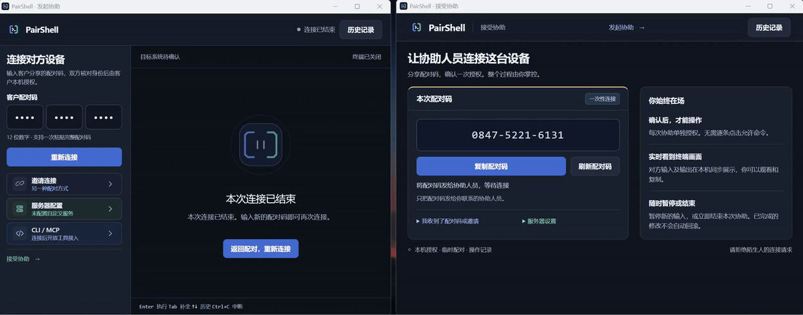
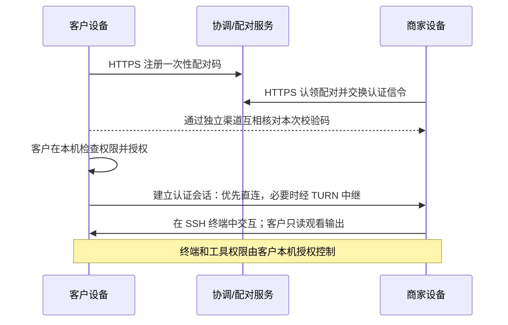

# PairShell

**轻量、安全、可审计的跨平台远程终端协助工具。**

PairShell 让求助方、协助方与协调服务各自处在清晰的安全边界内：双方先通过独立可信渠道核验本次连接，求助方再在自己的设备上明确授权。协调服务负责配对和转发，不能替求助方批准协助。

> PairShell 使用求助方当前系统账号的权限。请只授权你信任的协助方；如果以管理员身份运行，远程协助也会拥有相应权限。

<p align="center">
  <a href="https://github.com/densw/PairShell/releases/download/v1.1.2/PairShell-1.1.2-Windows-x64-Customer-Setup.exe">Windows 求助方安装包</a> ·
  <a href="https://github.com/densw/PairShell/releases/download/v1.1.2/PairShell-1.1.2-Windows-x64-Merchant-Setup.exe">Windows 协助方安装包</a> ·
  <a href="https://github.com/densw/PairShell/releases/download/v1.1.2/PairShell-1.1.2-macOS-universal.dmg">macOS 通用版 DMG</a> ·
  <a href="docs/deployment.md">Self-hosted</a>
</p>

🌐 官网：[pairshell.top](https://pairshell.top)（正在建设中）

本次 v1.1.2 更新 Windows 和 macOS 客户端安装包，不更新协调服务。既有服务无需升级；Linux CLI 与服务端包继续使用 [v1.1.1 Release](https://github.com/densw/PairShell/releases/tag/v1.1.1)。自建服务入口和网络要求见[部署说明](docs/deployment.md)。

## 🎬 双端协作演示

求助方生成一次性配对码，协助方输入配对码；双方通过已有可信渠道核对本次校验码，求助方在本机授权后，协助方开始操作终端，求助方同步只读观看并保留操作记录。

<p align="center">
  
</p>

## 核心特性

- **三方安全协助：** 求助方与协助方各自在 PairShell 查看本次校验码，并通过既有的电话、聊天或当面联系互相核对；配对码本身不代表身份，也不代表授权。
- **快速临时配对：** 一次性设备码五分钟有效；PAKE 建立配对秘密，生成端限制每个码最多验证三次。
- **求助方明确授权：** 求助方检查终端、命令任务、文件和 AI（MCP）能力后，在本机决定是否允许；可以暂停新输入或结束并撤权。
- **双方同步可见：** 协助方使用交互式终端，求助方可以只读观看同一 PTY 的输出。
- **本机审计：** 记录可验证和回放；原始审计事件保持只读。远端见证的周期检查点尚未完整接入客户端。
- **跨平台：** 提供 Windows 与 macOS 桌面客户端，以及 Windows、macOS、Linux CLI 和可自建协调服务。

## 工作原理



配对服务只协助两端发现彼此和交换信令。会话由两端本次密钥认证，远程执行通道通过 Pion DataChannel 承载 SSH；网络条件允许时直连，无法直连时可使用 TURN。中继可以阻断连接并观察连接元数据，但不能代替客户本机授权。详见[配对流程](docs/PAIRCODE.md)和[传输设计](docs/transport.md)。

## 快速开始

1. 从 [v1.1.2 Release](https://github.com/densw/PairShell/releases/tag/v1.1.2) 下载 Windows 求助方／协助方安装包或 macOS Universal DMG。Linux CLI 与服务端继续使用 [v1.1.1 Release](https://github.com/densw/PairShell/releases/tag/v1.1.1)。
2. 按[部署说明](docs/deployment.md)运行协调服务；双方在 PairShell 的连接设置中填写同一 HTTPS 服务地址。
3. 求助方打开客户端生成一次性配对码，协助方输入该码。双方通过已有可信渠道互相读出并核对完整校验码。
4. 求助方确认协助方身份、检查权限并授权。连接后求助方可只读观看协助方的终端操作，并随时暂停或结束会话。

不要把配对码、邀请或校验码发到公开渠道。结束协助不会撤销已发生的系统修改；已启动的程序在暂停期间也可能继续运行。

## 安全设计

PairShell 的三方分别是**求助方、协助方和协调服务运营者**。它将身份核验与执行授权分开：连接建立前由双方核验本次会话，执行能力则必须由求助方在本机单独批准。

| 参与方 | 保护边界 |
| --- | --- |
| 求助方 | 每次会话都在本机检查权限并决定是否授权；可暂停新操作或结束会话。所有操作使用当前系统账号能访问的路径和权限，不自动提权。 |
| 协助方 | 会话绑定本次经过核验的密钥；求助方可实时只读观看终端输出。协助方仍需谨慎处理从对端收到的文本、链接、文件和工具结果。 |
| 协调服务 | 帮助配对、交换认证信令并按需提供 TURN。满足两端软件和设备可信、会话秘密未泄露且双方完成独立校验的前提时，服务端管理权限不能替代任一端的会话私钥或求助方本机授权。服务仍能阻断连接并观察来源、时间和流量规模。 |

校验码应通过**独立于 PairShell 的已有可信渠道**互相核对；任何一方无法确认对方身份、校验码不一致或出现意外权限时，都应结束本次连接。求助方授权后，暂停会阻止新的输入，但不会自动停止已经运行的程序；结束授权也不会回滚已完成的更改。

审计记录保存在本机，可执行校验与回放；客户端尚未完成周期性远端见证闭环。安装包附有 SHA-256 清单和分离签名。验证前应通过独立渠道确认发布公钥或其指纹，不能只信任同一 Release 中随包下载的公钥。详细威胁模型见[三方安全协助说明](docs/trust.md)，签名步骤见[发布验证说明](docs/release-signing.md)。

**项目仍处于开发阶段，协议尚未通过独立安全审查。** v1.1.2 尚未完成真实 Windows 安装／卸载和 macOS 真机启动／Gatekeeper 验收；Windows 安装器没有 Authenticode 签名，macOS App 使用 ad-hoc 签名且未公证。详情见[1.1.2 发布说明](docs/RELEASE-1.1.2.md)及[实施台账](docs/IMPLEMENTATION.md)。

## 部署说明

- [自建协调服务与 TURN 配置](docs/deployment.md)
- [服务端部署与网络边界](docs/DEPLOYMENT-LAN-SERVER.md)
- [局域网 Windows 部署](docs/DEPLOYMENT-LAN-WINDOWS.md) · [局域网 macOS 部署](docs/DEPLOYMENT-LAN-MAC.md)

自建服务默认使用私有准入。只有运营者明确启用 `pairshelld -device-pairing` 后，才允许匿名设备码信箱；公开配对会消耗受配额限制的协调和中继资源。服务部署必须使用可信 TLS 证书，TURN 与公网入口应按部署文档限制访问范围。

## 开发者文档

桌面客户端之外，也可以通过 CLI、SSH 和 MCP 接入：

```powershell
pairshell host                         # 求助方生成配对码、核验并授权
pairshell connect                      # 协助方配对，完成双方核验后连接
pairshell connect --headless           # 完成相同核验后供 MCP 等工具接入
pairshell shell --session <本地引用>     # 附加原生命令行终端
pairshell mcp --session <本地引用>       # 启动与求助方授权绑定的 stdio MCP 服务
pairshell config --server https://your-relay.example
```

- [CLI 命令入口](cmd/pairshell) · [MCP 实现](internal/mcp) · [SSH 通道实现](internal/sshbridge)
- [配对与授权协议](docs/protocol.md) · [审计格式与边界](docs/audit.md) · [P2P 与中继传输](docs/transport.md)
- [功能清单](docs/FEATURES-AND-UX.md) · [实施状态和未完成事项](docs/IMPLEMENTATION.md)
- [贡献指南](CONTRIBUTING.md)

开发需要 Go 1.26 或以上。客户端运行时无需 Go、Node 或 Python。项目尚未确定自身开源许可证；提交贡献前请先阅读[贡献指南](CONTRIBUTING.md)。
